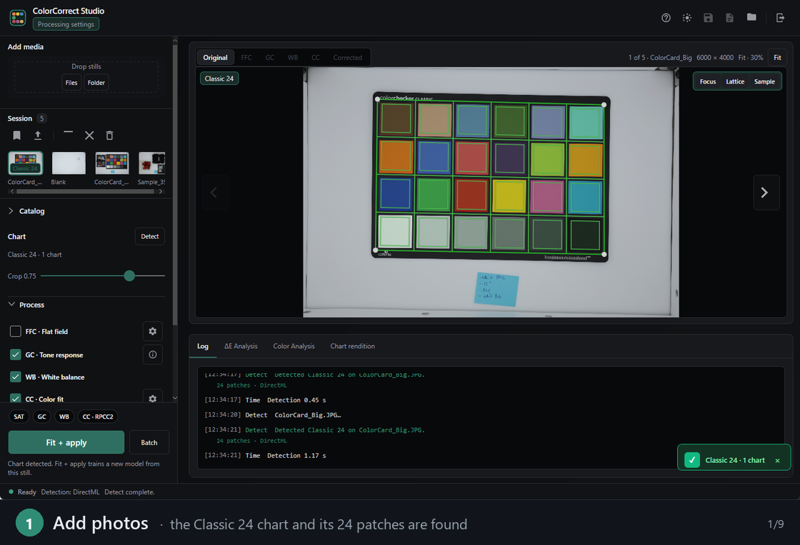

# ColorCorrect Studio

ColorCorrect Studio builds a color correction from a photograph of a color chart
and applies it to other photographs taken with the same camera and lighting. It
corrects in four stages: flat-field correction (FFC) for uneven lighting, tone
response (GC), white balance (WB) and color correction (CC). It runs locally on
Windows, Linux and Apple-silicon macOS, and has an optional Python SDK that uses
the same native engine.



[GIF version](docs/images/demo/studio.gif) · [Full-size screenshots of each step](docs/images/demo/README.md)

## Download

Version **0.5.1**. Each download contains the app, the correction engine and the
detection models; you do not need Python, .NET or Rust.

| Platform | Installer | Portable |
| --- | --- | --- |
| Windows 11 x64 | [Setup.exe](https://github.com/collinswakholi/ColorCorrectionPackage_UI/releases/download/v0.5.1/ColorCorrect-Studio-0.5.1-win-x64-Setup.exe) | [ZIP](https://github.com/collinswakholi/ColorCorrectionPackage_UI/releases/download/v0.5.1/ColorCorrect-Studio-0.5.1-win-x64.zip) |
| Windows 11 ARM64 | [Setup.exe](https://github.com/collinswakholi/ColorCorrectionPackage_UI/releases/download/v0.5.1/ColorCorrect-Studio-0.5.1-win-arm64-Setup.exe) | [ZIP](https://github.com/collinswakholi/ColorCorrectionPackage_UI/releases/download/v0.5.1/ColorCorrect-Studio-0.5.1-win-arm64.zip) |
| Ubuntu 24.04/22.04, Debian 13/12 x64 | [.deb](https://github.com/collinswakholi/ColorCorrectionPackage_UI/releases/download/v0.5.1/colorcorrect-studio_0.5.1_amd64.deb) | [.tar.gz](https://github.com/collinswakholi/ColorCorrectionPackage_UI/releases/download/v0.5.1/ColorCorrect-Studio-0.5.1-linux-x64.tar.gz) |
| Ubuntu 24.04/22.04, Debian 13/12 ARM64 | [.deb](https://github.com/collinswakholi/ColorCorrectionPackage_UI/releases/download/v0.5.1/colorcorrect-studio_0.5.1_arm64.deb) | [.tar.gz](https://github.com/collinswakholi/ColorCorrectionPackage_UI/releases/download/v0.5.1/ColorCorrect-Studio-0.5.1-linux-arm64.tar.gz) |
| macOS 14+ (Apple silicon) | — | [ZIP](https://github.com/collinswakholi/ColorCorrectionPackage_UI/releases/download/v0.5.1/ColorCorrect-Studio-0.5.1-osx-arm64.zip) · [.tar.gz](https://github.com/collinswakholi/ColorCorrectionPackage_UI/releases/download/v0.5.1/ColorCorrect-Studio-0.5.1-osx-arm64.tar.gz) |

Choose **x64** for Intel/AMD processors and **ARM64** for Arm. ARM64 and macOS
builds are experimental; see [compatibility](docs/compatibility.md). Checksums and
package manifests are on the
[release page](https://github.com/collinswakholi/ColorCorrectionPackage_UI/releases/tag/v0.5.1).

> **The downloads are not signed with a publisher certificate.** The Mac app is
> ad-hoc signed and not notarized, so macOS blocks its first launch; the
> [Mac installation guide](docs/macos-install.md) explains how to open it.

## Install

- **Windows:** run Setup, then open **ColorCorrect Studio**. For the portable
  version, extract the whole ZIP and run `ColorCorrect-Studio.cmd`.
- **Linux:** one `.deb` installs on Ubuntu 24.04 and 22.04 and Debian 13 and 12:

  ```sh
  sudo apt install ./colorcorrect-studio_0.5.1_amd64.deb   # ARM64: _arm64.deb
  colorcorrect-studio
  ```

  For the portable archive, extract it and run `./check-system`. If it reports
  missing libraries, run `./install-dependencies --install`, then
  `./ColorCorrect-Studio`.
- **macOS:** extract the ZIP, move **ColorCorrect Studio.app** to Applications
  and open it from there.

A GPU is optional; detection and correction fall back to the CPU. The
[installation guide](installer/README.md) covers prerequisites, checksums and
the experimental WSL GPU setup.

## Quick start

1. Add a photograph that contains the chart and press **Detect**. Check the patch
   overlay; if several charts are found, pick the right **Chart face**.
2. Keep the built-in reference values, or enter your own under
   **Correction settings → Chart references…**.
3. If the lighting is uneven, load a blank white-field photograph taken with the
   same setup in the FFC section.
4. Choose **Fit + apply**. Compare the stage previews and check the per-patch
   ΔE00 and the held-out validation, not only the training error.
5. Press **Ctrl+S** to save the corrected images and the model JSON. Previews are
   not saved until you do.
6. To correct more photographs from the same setup, choose **Model → Use loaded**,
   select the images and run **Apply model**.

Press **F1** for the offline in-app guide. Start with sRGB images; the
[user guide](docs/user-guide.md) explains custom references, batches, outputs and
[color interpretation](docs/user-guide.md#color-interpretation-matters).

## What's new in 0.5.1

A bug-fix release. On Linux and macOS the app always keeps its data in the
standard per-user folder; 0.5.0 could use, or fail on, the folder it was started
from. The Python SDK wheel is identical in every download, and the Windows
uninstaller removes every file.

## What's new in 0.5.0

- **Linux:** packages now install on Ubuntu 24.04 and 22.04 and Debian 13 and 12.
  `check-system` finds every missing library, including those loaded at runtime,
  and `install-dependencies` installs them.
- **Faster processing:** in fast mode, FFC runs in the same pass as the combined
  LUT, on the GPU when that is faster. A 24 MP photo takes 0.08–0.14 s instead of
  about 1.07 s on an RTX 4070 Ti SUPER, and the CPU path is faster too.
- **Fixes:** saving to a read-only folder no longer closes the app, moved photos
  can be relinked, right-click **Copy RGB / Lab / hex** works, and error messages
  are clearer. An idle window uses about 2% of a CPU core instead of 30%.
- **Guide:** the F1 guide is rewritten as task-first topics with figures from
  real fits.

The SDK stays at 3.0.0. See the [changelog](CHANGELOG.md) for every change.

## Python SDK

The SDK (`colorcorrect-studio` 3.0.0, Python 3.10+) runs the installed app's
engine without the GUI. Install the wheel from the app's `python/` folder:

```sh
python -m pip install "/path/to/runtime/python/colorcorrect_studio-3.0.0-py3-none-any.whl"
```

Set `root` to the app folder: `%LOCALAPPDATA%\Programs\ColorCorrect Studio` on
Windows, `/opt/colorcorrect-studio` for the Debian package, or
`/Applications/ColorCorrect Studio.app/Contents/Resources/runtime` on macOS.

```python
from colorcorrect import ColorCorrection, Config

with ColorCorrection(Config(save_path="results"), root="/path/to/ColorCorrectStudio") as cc:
    calibration = cc.run(Image="chart.jpg")  # add White_Image="blank.jpg" for FFC
    result = cc.predict_images(images=["scene1.jpg", "scene2.jpg"])
    print(calibration.metrics)
    print(result.outputs)
    calibration.export_lut("correction.cube")  # the LUT excludes FFC
```

Next: the [SDK guide](api/README.md), the
[configuration reference](docs/api/README.md#configuration-reference) and the
[tutorial notebooks](notebooks/README.md).

## Documentation

| Topic | Guide |
| --- | --- |
| Using the app | [User guide](docs/user-guide.md) |
| Installing | [Installation](installer/README.md) · [macOS](docs/macos-install.md) · [Compatibility](docs/compatibility.md) |
| GPU and processing options | [Processing and graphics](docs/compute/README.md) |
| Python | [SDK guide](api/README.md) · [API reference](docs/api/README.md) · [NDJSON protocol](docs/api/protocol.md) |
| Older models and sessions | [Migration notes](docs/migration.md) |
| Building and contributing | [Building](docs/building.md) · [Developer guide](docs/development/README.md) · [Contributing](CONTRIBUTING.md) |
| Release history | [Changelog](CHANGELOG.md) |

Unsigned development builds are on the
[Actions page](https://github.com/collinswakholi/ColorCorrectionPackage_UI/actions/workflows/native-builds.yml).

## Citation and license

The FFC → GC → WB → CC workflow follows Wakholi et al.,
[*A systematic color correction pipeline for controlled-environment imaging*](https://doi.org/10.1002/ppj2.70067),
*The Plant Phenome Journal* **9**(1), e70067 (2026). The earlier Python
implementation is [ColorCorrectionPipeline](https://pypi.org/project/ColorCorrectionPipeline/)
([source](https://github.com/collinswakholi/ColorCorrectionPackage)). For research
use, cite the study and the Studio version; [CITATION.cff](CITATION.cff) has the
references.

The application code is [MIT licensed](LICENSE). Bundled models and dependencies
have their own terms: see [third-party notices](THIRD_PARTY_NOTICES.md),
[model notices](models/NOTICE.md) and [model provenance](docs/model-provenance.md).
