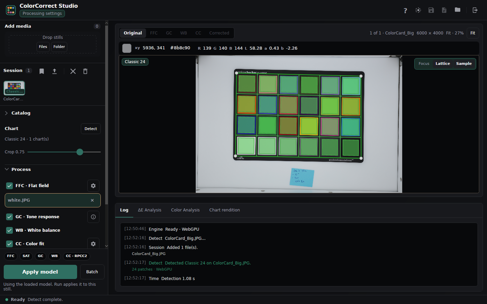

# ColorCorrect Studio

Turn a photographed color chart into a reusable correction for your still images.
Check the detected patches, fit the correction, inspect each stage, and apply the
saved model to photographs captured under the same conditions.

[Download 0.2.2](https://github.com/collinswakholi/ColorCorrectionPackage_UI/releases/tag/v0.2.2)
· [User guide](docs/user-guide.md) · [Python API](api/README.md)
· [Build from source](docs/building.md)



[Still screenshots and demo details](docs/images/demo/README.md)
· [GIF alternative](docs/images/demo/studio-dark.gif)

Prefer a still image? Open the screenshot gallery above.

The desktop app runs locally and includes its runtime, models and graphics
libraries. Python is optional.

## Download and install

**0.2.2** includes Windows and Ubuntu packages for x64 and ARM64, plus an
Apple-silicon application for macOS 14+. The downloads are not signed with a
publisher certificate. Mac apps use ad-hoc signing and are not notarized.
See the [platform notes](docs/compatibility.md) for requirements and limitations.

Auto detection can use a compatible GPU and recovers to CPU when needed. CPU
inference and CPU image correction are always available. Setup offers
**Recommended**, **CPU only**, and **Custom** choices without replacing system
graphics drivers.

| Platform | Installer | Portable application |
| --- | --- | --- |
| Windows 11 · x64 | [Setup.exe](https://github.com/collinswakholi/ColorCorrectionPackage_UI/releases/download/v0.2.2/ColorCorrect-Studio-0.2.2-win-x64-Setup.exe) | [ZIP](https://github.com/collinswakholi/ColorCorrectionPackage_UI/releases/download/v0.2.2/ColorCorrect-Studio-0.2.2-win-x64.zip) |
| Windows 11 · ARM64 | [Setup.exe](https://github.com/collinswakholi/ColorCorrectionPackage_UI/releases/download/v0.2.2/ColorCorrect-Studio-0.2.2-win-arm64-Setup.exe) | [ZIP](https://github.com/collinswakholi/ColorCorrectionPackage_UI/releases/download/v0.2.2/ColorCorrect-Studio-0.2.2-win-arm64.zip) |
| Ubuntu 24.04 · x64 | [.deb](https://github.com/collinswakholi/ColorCorrectionPackage_UI/releases/download/v0.2.2/colorcorrect-studio_0.2.2_amd64.deb) | [.tar.gz](https://github.com/collinswakholi/ColorCorrectionPackage_UI/releases/download/v0.2.2/ColorCorrect-Studio-0.2.2-linux-x64.tar.gz) |
| Ubuntu 24.04 · ARM64 | [.deb](https://github.com/collinswakholi/ColorCorrectionPackage_UI/releases/download/v0.2.2/colorcorrect-studio_0.2.2_arm64.deb) | [.tar.gz](https://github.com/collinswakholi/ColorCorrectionPackage_UI/releases/download/v0.2.2/ColorCorrect-Studio-0.2.2-linux-arm64.tar.gz) |
| Apple-silicon macOS 14+ | [Install the app](docs/macos-install.md) | [ZIP](https://github.com/collinswakholi/ColorCorrectionPackage_UI/releases/download/v0.2.2/ColorCorrect-Studio-0.2.2-osx-arm64.zip) · [tar.gz](https://github.com/collinswakholi/ColorCorrectionPackage_UI/releases/download/v0.2.2/ColorCorrect-Studio-0.2.2-osx-arm64.tar.gz) |

**x64** means 64-bit Intel/AMD; **ARM64** means 64-bit Arm. Choose your operating
system's native architecture. These packages do not target 32-bit x86.

Windows/Linux ARM64 graphics and Apple-silicon desktop workflows remain experimental.
A native build does not establish compatibility with every graphics device.

On **Windows**, run Setup and open **ColorCorrect Studio**. For a portable install,
extract the entire ZIP and run `ColorCorrect-Studio.cmd`. Setup offers the included
Microsoft Visual C++ prerequisite when needed; it does not replace GPU drivers.

On **Ubuntu**, install the matching Debian package, then launch the app from the
application menu or with `colorcorrect-studio`:

```sh
sudo apt install ./colorcorrect-studio_0.2.2_amd64.deb  # ARM64: use the _arm64.deb file
colorcorrect-studio
```

For a Linux portable install, extract the archive, run `./check-system`, and launch
`./ColorCorrect-Studio` from its extracted folder. The included
`./install-dependencies --install` offers explicit prerequisite setup on Ubuntu.

On **Apple-silicon macOS**, extract the ZIP and move **ColorCorrect Studio.app**
to Applications. Open it in Finder. The [Mac installation guide](docs/macos-install.md)
explains the first-launch security prompt, checksums, and optional Python setup.

Keep the app folder intact; its libraries and models are private to that
installation. Prerequisite setup offers system libraries when needed. Install
graphics drivers through your OS or GPU vendor.

Release assets include SHA-256 checksums and a manifest for each architecture.
See [installation details](installer/README.md) for prerequisites, verification,
portable use, and the optional experimental WSL GPU setup.

**WSL GPU use is experimental.** CPU detection and correction work without the
optional Mesa Dozen add-on. Official Linux downloads do not include that add-on;
use the [WSL setup instructions](installer/README.md#experimental-wsl-gpu-setup)
if you need GPU inference in WSL. Native Ubuntu uses its OS/vendor graphics driver.

## Your first correction

1. **Add a chart photograph and detect its chart.** Check the chart face and patch overlay.
   Select another face if the photograph contains multiple charts.
2. **Choose the reference.** Use built-in values, or enter/import your own measured
   values in the chart-reference editor. Review their cell mapping before fitting.
3. **Set the stages.** For uneven lighting, provide a matching blank-field photograph
   and enable **FFC**. Leave correction on **Auto** to start.
4. **Fit and inspect.** Choose **Fit + apply**, compare stage previews, and inspect
   patch errors and held-out validation. Cross-validation measures the CC fit;
   validate the complete pipeline on independent photographs as well.
5. **Save and reuse.** Export corrected images and the model JSON. Choose
   **Model → Use loaded** to apply that model to other images from the same setup.

Press **F1** for the searchable offline guide. Preview completion alone does not
export a full-resolution image; use **Save** to choose its destination.

## What you can do

- **Use your own references:** Classic/Passport and SpyderCHECKR 24 at 4×6, and
  Digital SG at 10×14; Lab, XYZ, or supported RGB encodings; manual entry,
  spreadsheet paste, CSV import, and reusable JSON profiles. Assign references
  to individual detected charts.
- **Choose a fitting method:** CCM, polynomial, root-polynomial, PLS, or neural
  network, with saved settings and model reuse.
- **Correct illumination and color:** spatial flat-field correction (**FFC**),
  tone response (**GC**), white balance (**WB**), and color correction (**CC**).
- **Process batches:** fit each chart image or apply one saved model. The existing
  FFC/GC/WB/CC/Save result indicators track each image. Turn **Preview results** on
  or off; full-resolution exports remain available with previews disabled.
- **Inspect and export:** stage previews, patch errors, reports, corrected images,
  model JSON, and `.cube` LUTs. A cube LUT excludes spatial FFC.
- **Resume work:** save sessions and relink moved images while preserving valid
  completed results and their captured settings.

## Processing and GPU support

**Auto**, **CPU**, and **GPU** select the device for image correction. All use the
combined **65³ GC/WB/CC LUT** by default. Auto selects CPU for small images and GPU
for larger ones; GPU correction retains CPU recovery. Spatial FFC remains separate.

Chart and plane detection use Auto: an eligible GPU first,
then CPU inference when GPU execution is unavailable or fails. Windows prefers **DirectML**; other
GPU routes use **WebGPU**. Advanced settings also offer explicit CPU detection.
Image correction retains independent Auto/CPU/GPU controls and CPU recovery.
[Processing options and setup](docs/compute/README.md)

For the full FFC/GC/WB pipeline, start with encoded **sRGB/D65** input. Embedded ICC
profiles and EXIF orientation are honored for that input path. Explicit other
encodings require the matching settings; exported pixels need the correct
interpretation downstream. See the [color interpretation guide](docs/user-guide.md#color-interpretation-matters).

## Python API

The optional SDK uses the same native engine without Python ML or GUI
dependencies. Install the bundled wheel from your app's `python/` folder, or
install from this source checkout:

```sh
python -m pip install ./api
```

Set `root` to the installed or extracted application folder. The default Windows
folder is `%LOCALAPPDATA%\Programs\ColorCorrect Studio`; the Debian package uses
`/opt/colorcorrect-studio`. For the Mac application, use
`/Applications/ColorCorrect Studio.app/Contents/Resources/runtime`.

```python
from colorcorrect import ColorCorrection, Config

with ColorCorrection(Config(save_path="results"), root="/path/to/ColorCorrectStudio") as cc:
    calibration = cc.run(Image="chart.jpg")  # Optional: White_Image="blank.jpg"
    result = cc.predict_images(images=["scene1.jpg", "scene2.jpg"])
    print(calibration.metrics)
    print(result.outputs)
    calibration.export_lut("correction.cube")
```

The desktop application is **0.2.2**.
The independently versioned SDK is **2.2.2**. Its wheel does not include the native
worker or models. For custom references, typed
options, model reload, and partial batch failures, see the [API guide](api/README.md)
and [typed API reference](docs/api/README.md).

The [configuration examples](docs/api/README.md) show FFC settings, GC/WB stage
switches, CC methods, and application overrides. The [workflow notebook](notebooks/01_headless_workflow.ipynb)
and [method comparison notebook](notebooks/02_compare_fit_methods.ipynb) provide
step-by-step, editable examples.

## Research and citation

ColorCorrect Studio follows the stepwise FFC → GC → WB → CC workflow described
by Wakholi and colleagues in [*A systematic color correction pipeline for
controlled-environment imaging*](https://doi.org/10.1002/ppj2.70067), *The Plant
Phenome Journal*, **9**(1), e70067 (2026).

The original [ColorCorrectionPipeline package on PyPI](https://pypi.org/project/ColorCorrectionPipeline/)
and its [source repository](https://github.com/collinswakholi/ColorCorrectionPackage)
provide the earlier Python implementation. Studio uses a native Rust engine and
offers a familiar `ColorCorrection`/`Config` workflow with its own documented
algorithms, file-based inputs, typed results, and model format. See the
[API compatibility notes](api/README.md) before migrating existing scripts.

For research use, cite the study, the original package where applicable, and the
Studio version used. [CITATION.cff](CITATION.cff) contains machine-readable
software and research references.

## Source and contributions

Build with **.NET SDK 10.0.402** and **Rust 1.95.0**, or browse unreleased builds on
the [Actions page](https://github.com/collinswakholi/ColorCorrectionPackage_UI/actions/workflows/native-builds.yml).
These unsigned builds are separate from the published release downloads above.

[Build instructions](docs/building.md) · [Developer guide](docs/development/README.md)
· [Contributing](CONTRIBUTING.md) · [Migration notes](docs/migration.md)

The application processes still images. Settings and sessions retain the legacy
`CCP-New` data location for compatibility. Keep your models, sessions, and exports
outside the application installation folder.

Application code is [MIT licensed](LICENSE). Bundled models and dependencies have
separate terms; read [third-party notices](THIRD_PARTY_NOTICES.md),
[model notices](models/NOTICE.md), and [model provenance](docs/model-provenance.md).
