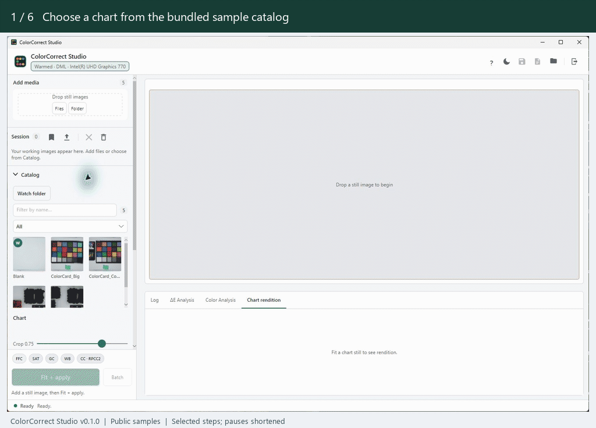

# ColorCorrect Studio

[](https://github.com/collinswakholi/ColorCorrectionPackage_UI/releases/latest)
[](https://github.com/collinswakholi/ColorCorrectionPackage_UI/releases/tag/v0.1.0)
[](LICENSE)

Turn a photographed color chart into a reusable calibration for your still images.
Detect the chart, correct lighting and color, inspect the results, and apply the
saved model to images from the same capture setup.

**A native desktop app that works offline.** No browser server, Python ML setup,
or separately installed .NET runtime is needed to use the app.



*Selected moments from the installed v0.1.0 app using the bundled public samples.
Pauses are shortened; GIF colors are approximate. [Static workbench view](docs/images/session-workbench.png).*

[Download](#download) · [Quick start](#quick-start) · [Features](#features) ·
[Python API](#python-api) · [Documentation](#documentation) · [Build](#build-and-contribute)

## Download

**[Download ColorCorrect Studio v0.1.0 for Windows](https://github.com/collinswakholi/ColorCorrectionPackage_UI/releases/download/v0.1.0/ColorCorrect-Studio-win-x64.exe)**
or open the [release page](https://github.com/collinswakholi/ColorCorrectionPackage_UI/releases/tag/v0.1.0)
for checksums, release notes, and dependency information.

| Platform | Availability |
| --- | --- |
| **Windows 11 x64** | v0.1.0 installer — current main release |
| Linux x64 | Source and packaging script; native host validation pending, no v0.1.0 binary |
| macOS arm64 | Source and packaging script; native host validation pending, no v0.1.0 binary |

Run Setup, then open **ColorCorrect Studio**. The installer includes CPU libraries,
detector weights, five example images, illustrated offline help, the Python SDK,
and notebooks. CUDA is an optional separate download.

The Windows installer is **unsigned**. Check its source and SHA-256 before running
it; Windows may display a SmartScreen warning.

<details>
<summary>Verify the download and installation details</summary>

Download `ColorCorrect-Studio-win-x64.exe.sha256` and `build-info.json` from the
same release. Compare the checksum:

```powershell
Get-FileHash .\ColorCorrect-Studio-win-x64.exe -Algorithm SHA256
```

The source commit in `build-info.json` must match the `v0.1.0` tag. The released
installer remains tied to that commit as documentation on `main` evolves.
It was first built as a preview and later promoted to Latest; its original
`preview: true` build record remains unchanged.

Setup can coexist with the old **ColorCorrector** app and preserves existing
CPU/CUDA add-ons. Store models, sessions, and exports outside the install folder.
Uninstall removes installed app files and retains the native `CCP-New` user-data
directory.

</details>

## Quick start

1. **Add a chart image.** Expand **Catalog** and click `ColorCard_Big`, or use
   **Files** to open your own photo. Inspect the automatic detection overlay;
   use **Detect** to retry. Confirm the correct chart face and patch alignment.
2. **Set the blank field, if using FFC.** Click **W** on `Blank.JPG` in Catalog,
   or load your own blank in FFC settings. This separate white image measures
   uneven illumination; it is not the chart image.
3. **Choose the stages and fit method.** Open the CC settings gear, choose a
   fitting method, then press **Fit + apply** (F5).
4. **Check the result.** Switch between **Original**, **FFC**, **GC**, **WB**,
   **CC**, and **Corrected**. Inspect per-patch ΔE00 and held-out validation.
5. **Save and reuse.** Press **Ctrl+S** and **Save selected** to write images and
   reports. Save the calibration as JSON; choose **Model → Use loaded** to apply
   it to other images captured under matching conditions.


Browse session images with the preview arrows or **Alt+Left / Alt+Right**. The
stage tabs change processing stages. Press **F1** or **?** for illustrated help.
Preview completion does not save full-resolution images; export them explicitly.

## Features

| Correction stage | What it uses |
| --- | --- |
| **FFC · Flat-field correction** | A separate, matching blank-field photo to correct spatial illumination |
| **GC · Tone response** | Named neutral patches on the detected chart; automatic fitting, no degree setting |
| **WB · White balance** | Named chart neutrals to estimate channel balance |
| **CC · Color correction** | Chart color patches to fit a reusable color transform |

- **Six fitting methods:** CCM, root-polynomial degree 2, root-polynomial degree
  3, polynomial, PLS, and neural network. The API calls the polynomial method `linear`.
- **Configurable NN:** widths such as `100` or `[64, 32]`, Adam/SGD/RMSProp,
  batch normalization, and dropout.
- **Visual inspection:** chart overlays, stage previews, RGB/Lab probes, ΔE00
  analysis, color plots, and chart rendition.
- **Session and batch tools:** searchable sample catalog, multiple images,
  saved sessions, model reuse, and selected image/stage/report exports.
- **Portable calibration:** native JSON models and `.cube` LUT export for the
  global transform. A cube cannot include spatial FFC.
- **Local automation:** the same correction worker is available through a
  JSON-lines process API and the bundled Python SDK 1.1.

**Still images only.** Video processing and FFmpeg/ffprobe are not included.

## Python API

From the installed app folder or a built checkout, with Python 3.10+:

```powershell
python api/colorcorrect.py devices
```

The SDK uses Python's standard library. Add the bundled `api/` folder to the
import path, then calibrate and apply:

```python
from pathlib import Path
import sys
sys.path.insert(0, str(Path("api").resolve()))
from colorcorrect import Engine

with Engine() as engine:
    calibration = engine.calibrate(
        "test_images/ColorCard_Big.JPG",
        white="test_images/Blank.JPG", model="rpcc2", cross_validate=True,
    )
    print(calibration.report["report_json"].get("validation_delta_e_2000"))
    calibration.apply(["test_images/Sample_3572.JPG"])
    print(calibration.model)  # Model and results are in temporary storage by default.
```

Set `folder=` to keep calibration results in a folder you choose. Inspect the
validation report before reusing a fit. No HTTP service or API key is involved.
All low-level correction options remain available in the
[API guide](docs/api/README.md).

Try the [complete workflow notebook](notebooks/01_headless_workflow.ipynb) or
[compare all six methods and NN settings](notebooks/02_compare_fit_methods.ipynb).
Copy notebooks to a writable folder and set `COLORCORRECT_ROOT` to the installed
app folder; [notebook setup](docs/api/README.md#runnable-notebooks-and-tests)
lists the optional dependencies.

## Before relying on the colors

- **Match the capture setup.** Use an appropriate physical chart with fixed
  lighting, exposure, and camera settings. A detected layout does not establish
  that its colors match a bundled reference. FFC needs a matching blank field.
- **Check independent accuracy.** Held-out chart scores assess CC conditional on
  the fitted GC/WB stages. Validate the whole setup with a separately photographed
  chart. An apply-only image without a chart has no measured chart ΔE00.
- **Declare the encoding.** For sRGB/D65 input, embedded ICC profiles normalize
  to working sRGB; untagged input is assumed sRGB. Explicit non-sRGB encodings
  bypass ICC conversion and must match the pixels. FFC/GC/WB require encoded
  sRGB/D65. Non-sRGB exports do not automatically get a matching ICC profile.
  The preview is not a calibrated proofing viewer.
- **Check actual acceleration.** CUDA can accelerate chart inference and LUT
  image application; DirectML can accelerate plane detection and LUT application.
  NN training, regression, and many preprocessing stages run on CPU. Request
  telemetry reports which backend actually ran.

## Documentation

| I want to… | Start here |
| --- | --- |
| Learn the desktop workflow | [Illustrated user guide](docs/user-guide.md), also available offline with F1 |
| Automate processing or run notebooks | [API guide and examples](docs/api/README.md) |
| Check color conversions and validation | [Color-science validation](docs/color-science-validation.md) |
| Move from the old browser app | [Migration guide](docs/migration.md) |
| Review release testing | [Live UI / Windows 11 record](docs/validation-still-preview.md) and [final evidence](https://github.com/collinswakholi/ColorCorrectionPackage_UI/pull/1#issuecomment-6198637794) |

The former browser/Flask releases are **retired**. Their historical downloads
remain available on [GitHub Releases](https://github.com/collinswakholi/ColorCorrectionPackage_UI/releases).
Legacy source is preserved on [legacy-web](https://github.com/collinswakholi/ColorCorrectionPackage_UI/tree/legacy-web)
and [legacy-web-final](https://github.com/collinswakholi/ColorCorrectionPackage_UI/tree/legacy-web-final).
REST clients must migrate to the process API; old `.pkl` models require refitting
to native JSON. Existing legacy Docker images contain the old web app.

## Build and contribute

| Layer | Stack |
| --- | --- |
| Desktop | Avalonia / C#, .NET SDK **10.0.402** |
| Correction and detection | Rust **1.95.0**, LibTorch 2.9.1, ONNX Runtime / DirectML |
| Automation | Native NDJSON worker and Python SDK **1.1** |
| Windows distribution | Self-contained app with Inno Setup installer |

Native source lives at the repository root: `app/`, `engine/`, `api/`, `models/`,
`refs/`, `notebooks/`, and `test_images/`. Start with [building and testing](docs/building.md),
[CONTRIBUTING](CONTRIBUTING.md), [release procedures](docs/releasing.md),
[SECURITY](SECURITY.md), and [CHANGELOG](CHANGELOG.md).

## Research and licenses

By [Collins Wakholi](https://github.com/collinswakholi), building on the
[ColorCorrectionPipeline](https://github.com/collinswakholi/ColorCorrectionPackage)
project and Wakholi et al. (2026), *A systematic color correction pipeline for
controlled-environment imaging*, The Plant Phenome Journal 9(1), e70067.
[Read the study](https://doi.org/10.1002/ppj2.70067) · [Citation metadata](CITATION.cff).
The illustrated app guide is bundled offline; the study PDF is not bundled.

Application source retains the [MIT license and attribution](LICENSE).
Dependencies and detector weights have separate terms, including an AGPL notice
for the supplied Ultralytics detector. See [third-party notices](THIRD_PARTY_NOTICES.md)
and [model provenance and source access](docs/model-provenance.md).
