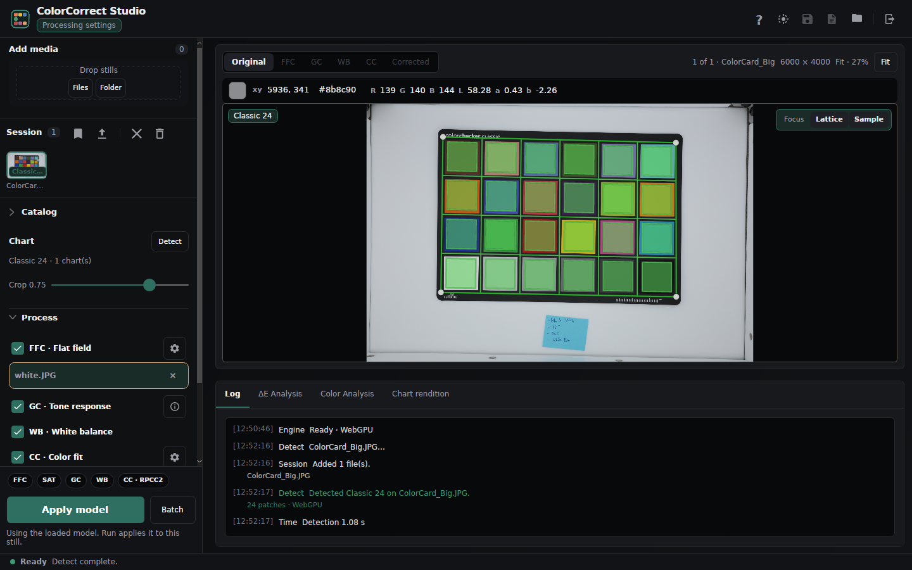

# ColorCorrect Studio

ColorCorrect Studio builds a color correction from a photograph of a color chart
and applies it to other still images taken with the same camera and lighting. It
corrects in four stages: flat-field correction (FFC) for uneven lighting, tone
response (GC), white balance (WB) and color correction (CC). It runs locally on
Windows, Ubuntu and Apple-silicon macOS, and includes an optional Python SDK that
uses the same native engine.



[Screenshot gallery](docs/images/demo/README.md)

## Download and install

Version **0.4.0**. Each download includes the app, the correction engine and the
detection models. You do not need Python, .NET or Rust to use the app.

| Platform | Installer | Portable |
| --- | --- | --- |
| Windows 11 x64 | [Setup.exe](https://github.com/collinswakholi/ColorCorrectionPackage_UI/releases/download/v0.4.0/ColorCorrect-Studio-0.4.0-win-x64-Setup.exe) | [ZIP](https://github.com/collinswakholi/ColorCorrectionPackage_UI/releases/download/v0.4.0/ColorCorrect-Studio-0.4.0-win-x64.zip) |
| Windows 11 ARM64 | [Setup.exe](https://github.com/collinswakholi/ColorCorrectionPackage_UI/releases/download/v0.4.0/ColorCorrect-Studio-0.4.0-win-arm64-Setup.exe) | [ZIP](https://github.com/collinswakholi/ColorCorrectionPackage_UI/releases/download/v0.4.0/ColorCorrect-Studio-0.4.0-win-arm64.zip) |
| Ubuntu 24.04 x64 | [.deb](https://github.com/collinswakholi/ColorCorrectionPackage_UI/releases/download/v0.4.0/colorcorrect-studio_0.4.0_amd64.deb) | [.tar.gz](https://github.com/collinswakholi/ColorCorrectionPackage_UI/releases/download/v0.4.0/ColorCorrect-Studio-0.4.0-linux-x64.tar.gz) |
| Ubuntu 24.04 ARM64 | [.deb](https://github.com/collinswakholi/ColorCorrectionPackage_UI/releases/download/v0.4.0/colorcorrect-studio_0.4.0_arm64.deb) | [.tar.gz](https://github.com/collinswakholi/ColorCorrectionPackage_UI/releases/download/v0.4.0/ColorCorrect-Studio-0.4.0-linux-arm64.tar.gz) |
| macOS 14+ (Apple silicon) | — | [ZIP](https://github.com/collinswakholi/ColorCorrectionPackage_UI/releases/download/v0.4.0/ColorCorrect-Studio-0.4.0-osx-arm64.zip) · [.tar.gz](https://github.com/collinswakholi/ColorCorrectionPackage_UI/releases/download/v0.4.0/ColorCorrect-Studio-0.4.0-osx-arm64.tar.gz) |

Choose **x64** for 64-bit Intel/AMD and **ARM64** for 64-bit Arm. ARM64 and macOS
builds are experimental; see [compatibility](docs/compatibility.md). Checksums
and manifests for each platform are on the
[release page](https://github.com/collinswakholi/ColorCorrectionPackage_UI/releases/tag/v0.4.0).

> **The downloads are not signed with a publisher certificate.** The Mac app is
> ad-hoc signed and not notarized, so macOS blocks its first launch. The
> [Mac installation guide](docs/macos-install.md) explains how to open it.

- **Windows:** run Setup, then open **ColorCorrect Studio**. For the portable
  version, extract the whole ZIP and run `ColorCorrect-Studio.cmd`.
- **Ubuntu:** install the package, then start the app from the application menu
  or a terminal:

  ```sh
  sudo apt install ./colorcorrect-studio_0.4.0_amd64.deb   # ARM64: _arm64.deb
  colorcorrect-studio
  ```

  For the portable archive, extract it, run `./check-system`, then
  `./ColorCorrect-Studio`.
- **macOS:** extract the ZIP, move **ColorCorrect Studio.app** to Applications
  and open it from there.

Keep the installed or extracted folder intact. A GPU is optional: detection and
correction fall back to the CPU. Prerequisites, verification and the experimental
WSL GPU setup are covered in the [installation guide](installer/README.md).

## Your first correction

1. Add a photograph that contains the chart and press **Detect**. Check the patch
   overlay; if several charts are found, pick the right **Chart face**.
2. Keep the built-in reference values, or enter your own measured values under
   **Correction settings → Chart references…**.
3. If the lighting is uneven, load a blank white-field photograph taken with the
   same setup in the FFC section. Leave the other settings at their defaults.
4. Choose **Fit + apply**. Compare the stage previews and check the per-patch
   ΔE00 and held-out validation, not only the training error.
5. Press **Ctrl+S** to save the corrected images and the model JSON. Previews are
   not saved until you do this.
6. To correct more photographs from the same setup, choose **Model → Use loaded**,
   select the images and run **Apply model**.

Press **F1** in the app for the offline guide. The [user guide](docs/user-guide.md)
covers custom references, batches, outputs and
[color interpretation](docs/user-guide.md#color-interpretation-matters) (start
with sRGB images).

## Python SDK

The SDK (`colorcorrect-studio` 3.0.0, Python 3.10+) runs the installed app's
engine without the GUI. Install the wheel from the app's `python/` folder:

```sh
python -m pip install "/path/to/runtime/python/colorcorrect_studio-3.0.0-py3-none-any.whl"
```

Set `root` to the app folder: `%LOCALAPPDATA%\Programs\ColorCorrect Studio` on
Windows, `/opt/colorcorrect-studio` for the Debian package, or
`/Applications/ColorCorrect Studio.app/Contents/Resources/runtime` on macOS.

```python
from colorcorrect import ColorCorrection, Config

with ColorCorrection(Config(save_path="results"), root="/path/to/ColorCorrectStudio") as cc:
    calibration = cc.run(Image="chart.jpg")  # add White_Image="blank.jpg" for FFC
    result = cc.predict_images(images=["scene1.jpg", "scene2.jpg"])
    print(calibration.metrics)
    print(result.outputs)
    calibration.export_lut("correction.cube")  # the LUT excludes FFC
```

Next: the [SDK guide](api/README.md), the
[configuration reference](docs/api/README.md#configuration-reference) and the
[tutorial notebooks](notebooks/README.md).

## Documentation

- [User guide](docs/user-guide.md): the desktop workflow in detail
- [Installation](installer/README.md) and [macOS installation](docs/macos-install.md)
- [Compatibility](docs/compatibility.md) and [processing and GPU options](docs/compute/README.md)
- [Python SDK](api/README.md) and [API reference](docs/api/README.md)
- [Migration notes](docs/migration.md) for models and sessions from older versions
- [Changelog](CHANGELOG.md)

## Build from source

Building needs .NET SDK 10.0.402 and Rust 1.95.0; see
[building from source](docs/building.md), the
[developer guide](docs/development/README.md) and [contributing](CONTRIBUTING.md).
Unsigned development builds are on the
[Actions page](https://github.com/collinswakholi/ColorCorrectionPackage_UI/actions/workflows/native-builds.yml).

## Citation and license

The FFC → GC → WB → CC workflow follows Wakholi et al.,
[*A systematic color correction pipeline for controlled-environment imaging*](https://doi.org/10.1002/ppj2.70067),
*The Plant Phenome Journal* **9**(1), e70067 (2026). The earlier Python
implementation is [ColorCorrectionPipeline](https://pypi.org/project/ColorCorrectionPipeline/)
([source](https://github.com/collinswakholi/ColorCorrectionPackage)). For research
use, cite the study and the Studio version; [CITATION.cff](CITATION.cff) has the
references.

The application code is [MIT licensed](LICENSE). Bundled models and dependencies
have their own terms: see [third-party notices](THIRD_PARTY_NOTICES.md),
[model notices](models/NOTICE.md) and [model provenance](docs/model-provenance.md).
