# ColorCorrect Studio in dark mode

Watch the workflow in **25.32 seconds**: load a photograph, detect its chart,
choose correction settings, compare the stages, and explore the expanded results.

[Animated PNG](studio-dark.png) · [GIF alternative](studio-dark.gif) · [Project README](../../../README.md)

The animated PNG and still screenshots preserve the captured colors. The GIF
uses a limited palette; choose the PNGs for a closer look at photographs and figures.
The still gallery below shows the same workflow without animation. Open any
screenshot at full size to read the controls and enlarged figures.

## Still screenshot gallery

<!-- demo-gallery:start -->

### A public chart photograph loaded

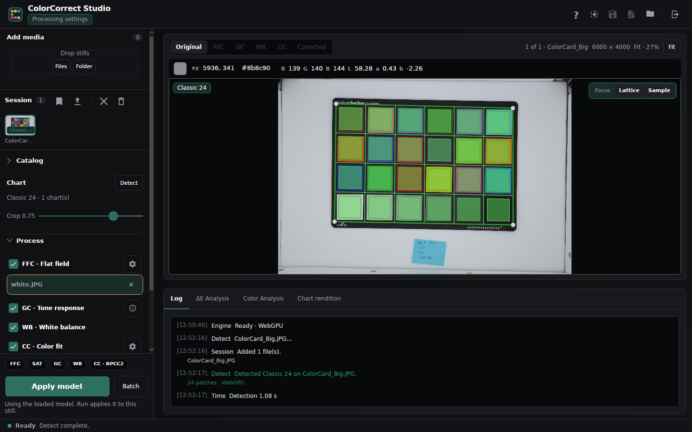

### Detected chart and patch overlay

### Simple correction device and detection-engine settings

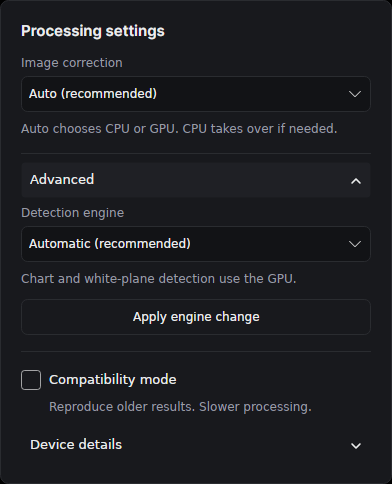

### Color-correction settings

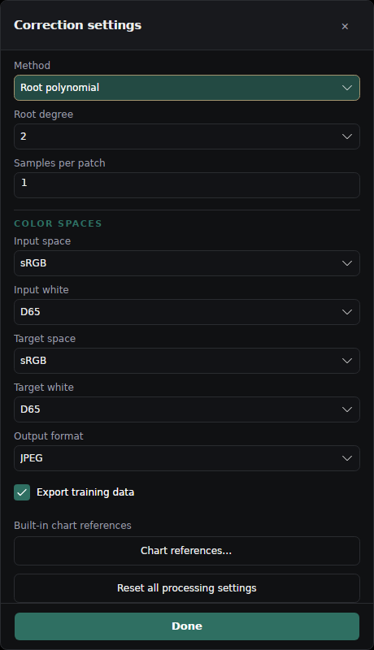

### Actual correction in progress

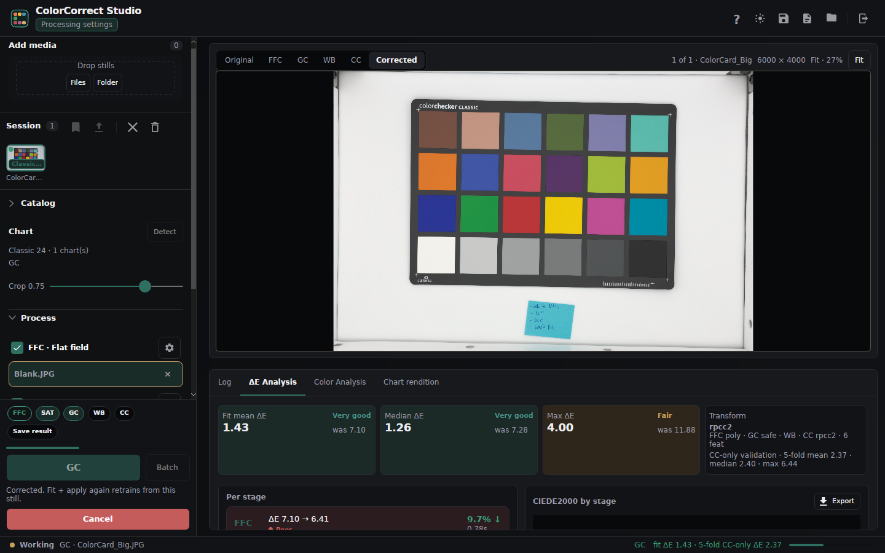

### Original photograph

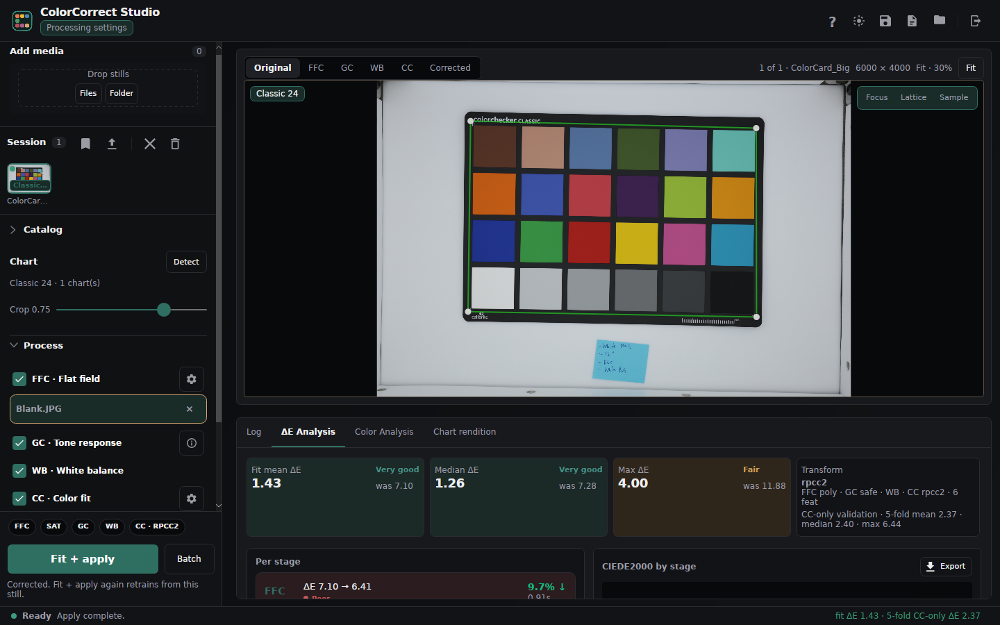

### After flat-field correction

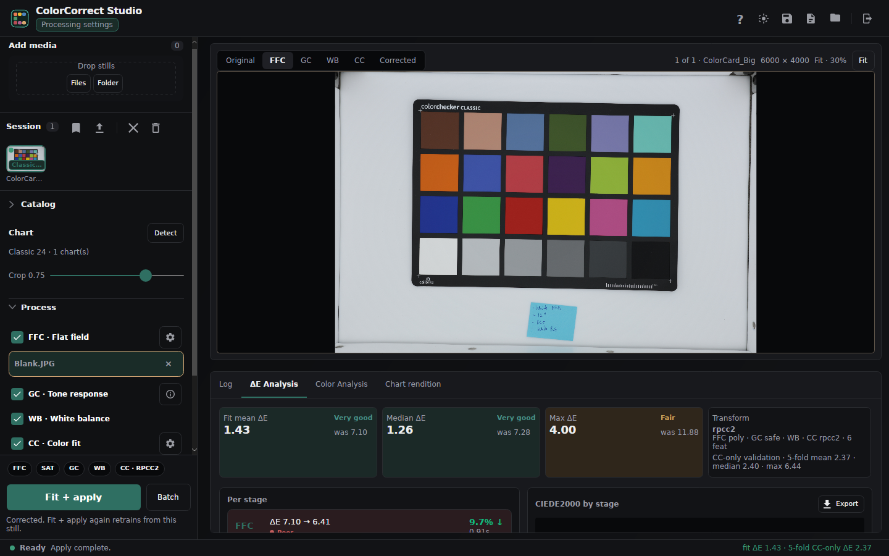

### After tone-response correction

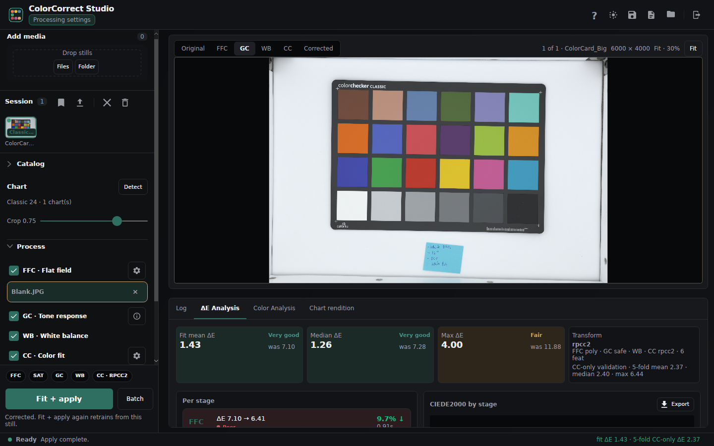

### After white balance

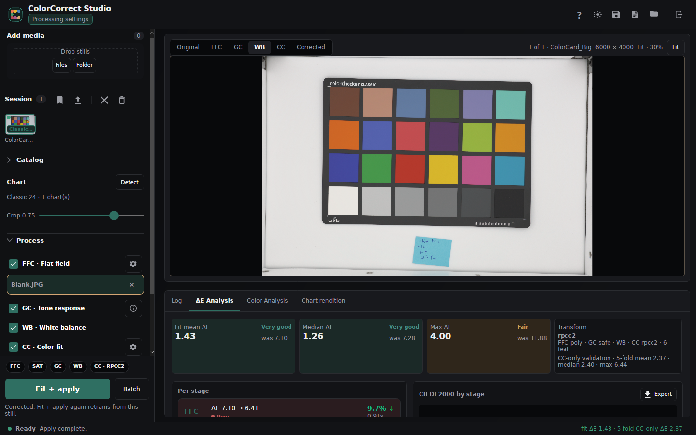

### Corrected result

### Expanded color-difference analysis

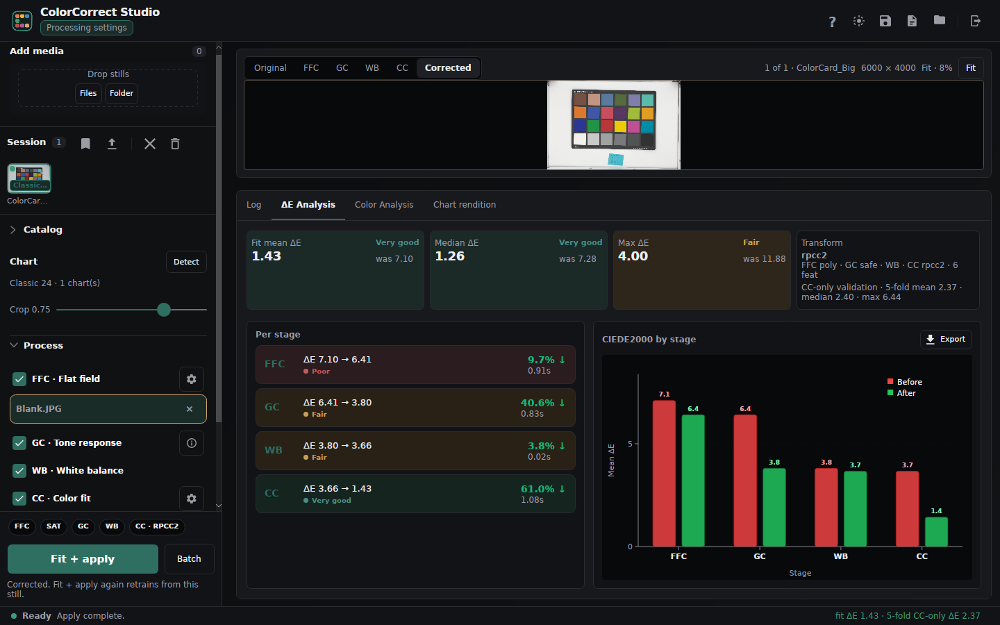

### Expanded color analysis

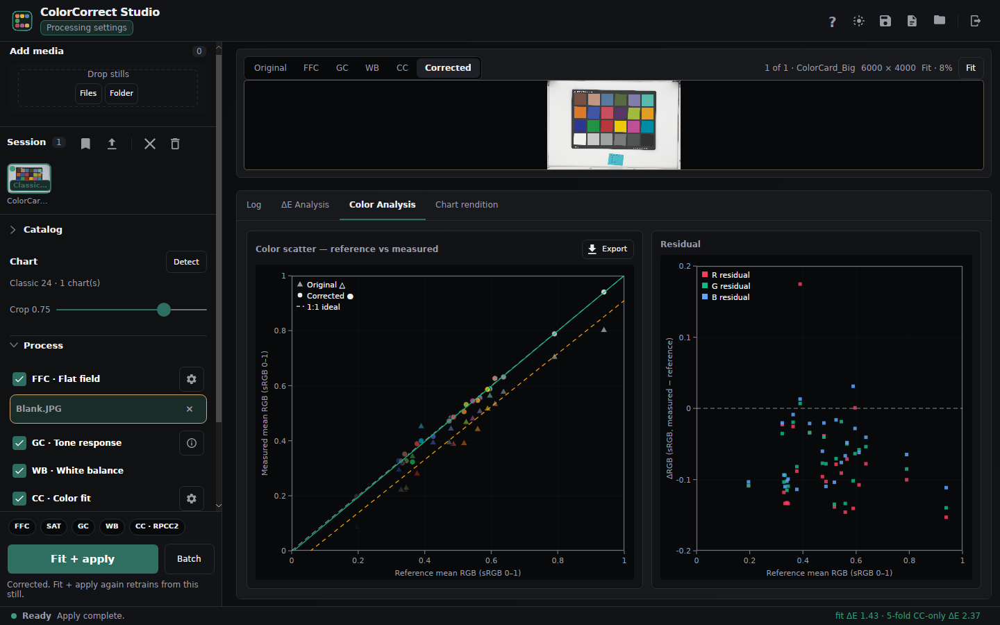

### Expanded chart rendition

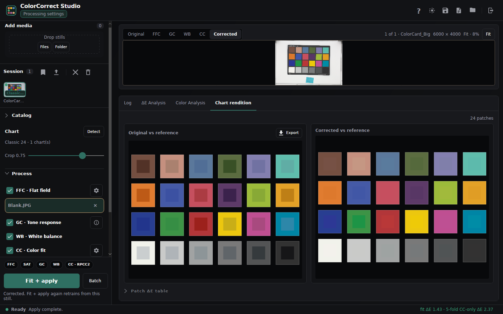

### Four-image batch with previews disabled

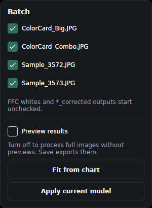

<!-- demo-gallery:end -->

[Capture and encoding instructions](../../development/demo.md)
