# ColorCorrect Studio 0.5.0 tour

[Animated tour (lossless PNG)](studio.png) · [GIF version](studio.gif) · [Project README](../../../README.md)

The tour shows settled screens of the real 0.5.0 app on Windows, with the area that matters
in each step spotlighted at the app's own pixels. It uses the public photos in
[`test_images/`](../../../test_images). The animated PNG is lossless: every frame keeps the
app's exact colors. The GIF version is limited to 256 colors per frame, so its colors are
close but not exact. The screenshots below are full size.

## 1. Add photos and detect the chart

The Classic 24 chart is found and its 24 patches are outlined.

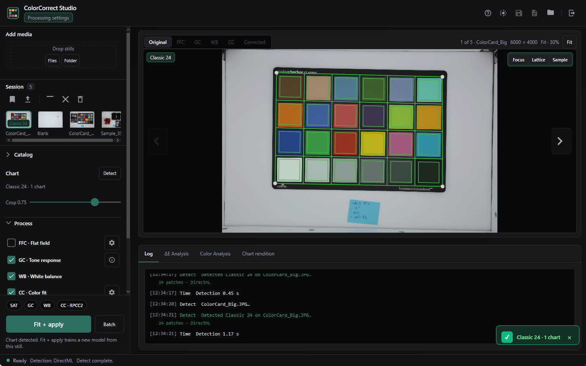

## 2. Processing settings

Auto times the CPU and the GPU on the first large image and uses the faster one.

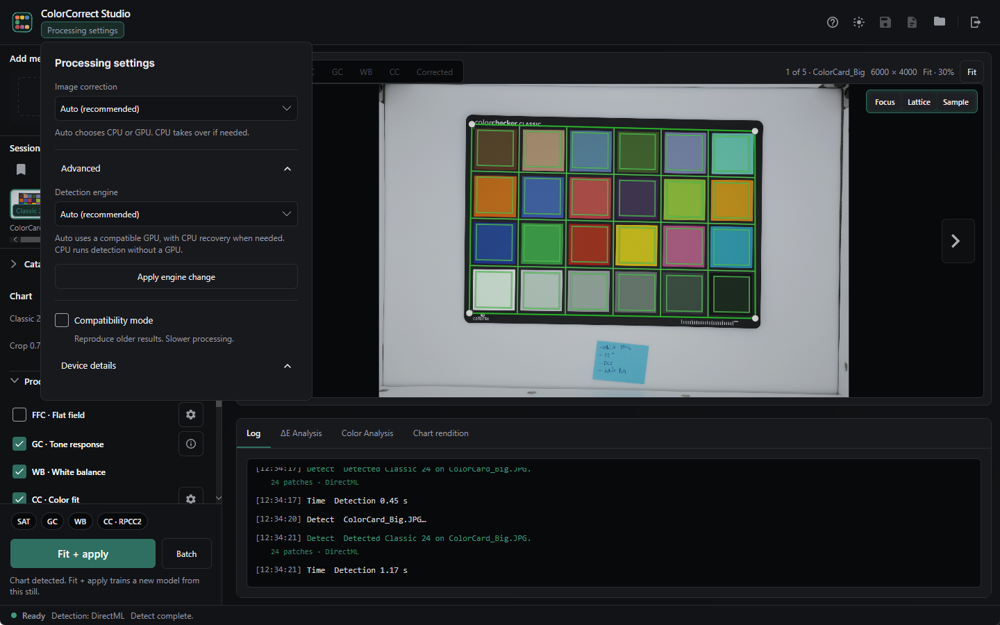

## 3. Color correction settings

The model, its degree and the color spaces.

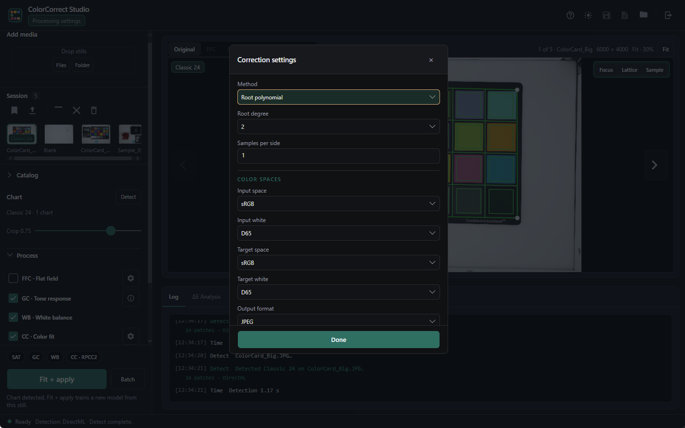

## 4. Flat-field correction

Blank.JPG, a photo of a blank white board, is the white reference that evens out the lighting.

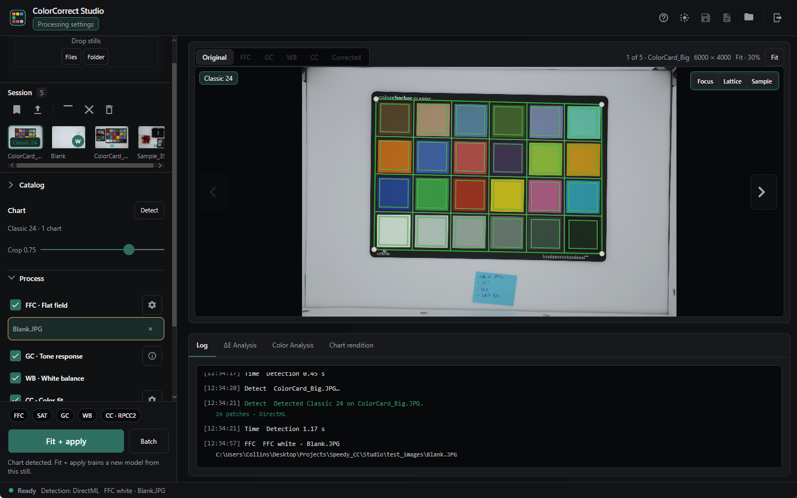

## 5. Fit + apply

Mean ΔE on the chart drops from 7.10 to 1.42.

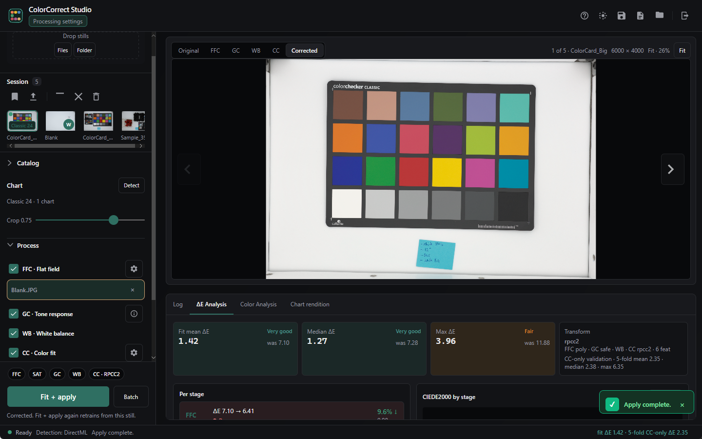

## 6. Inspect each stage

Original, FFC, GC, WB and CC each show the photo after that stage. This is the FFC stage.

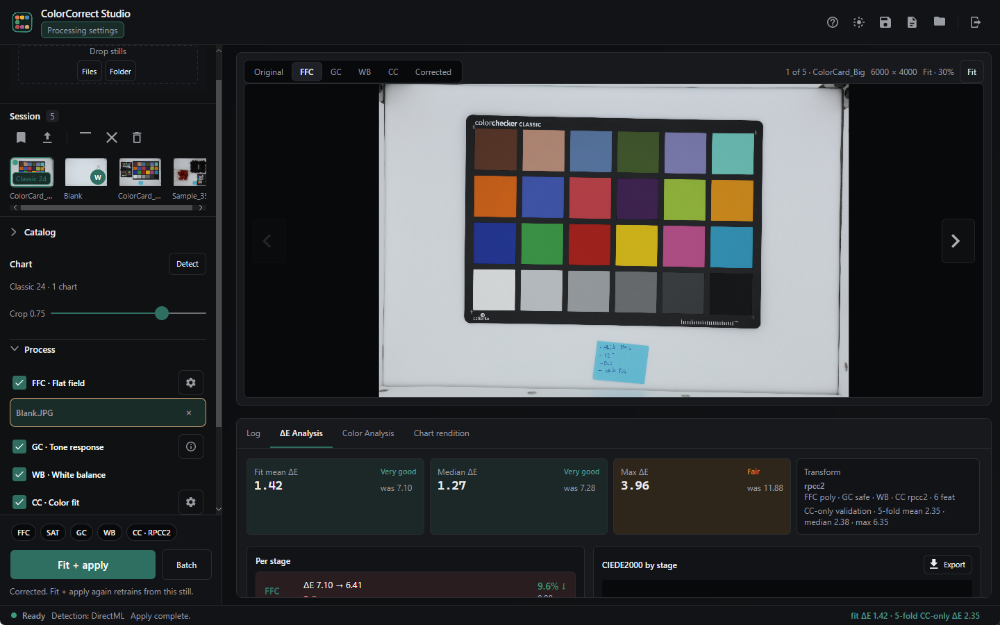

## 7. Read and copy colors

Hovering shows RGB, hex and Lab under the pointer. Right-click copies them.

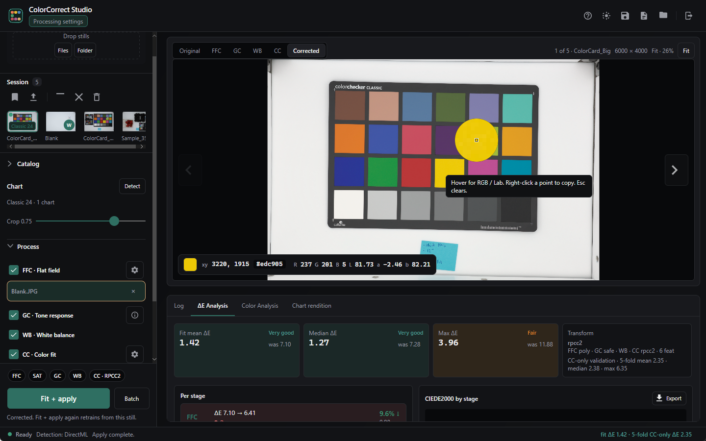

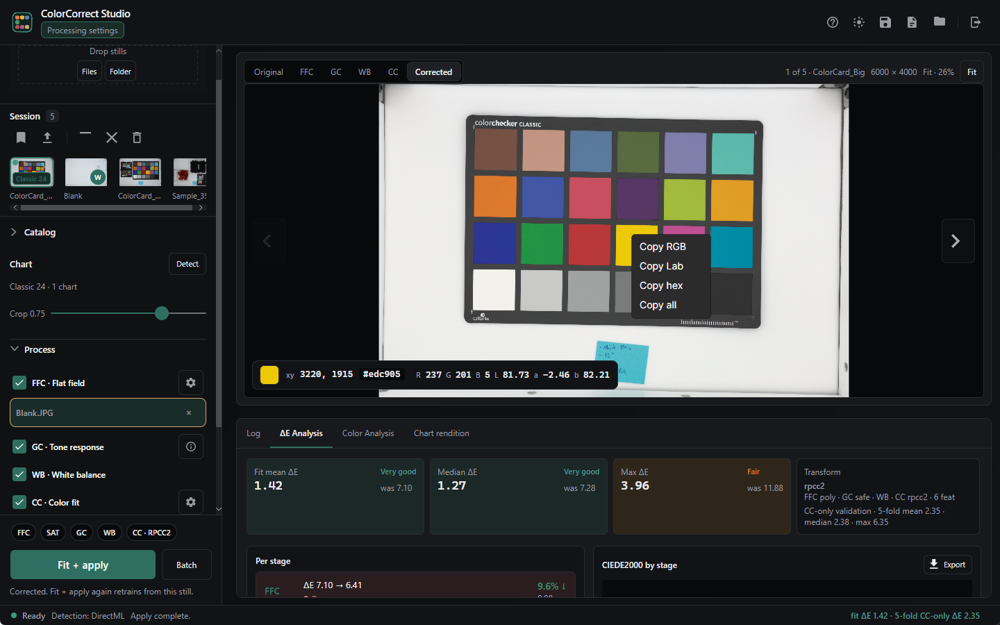

## 8. Check the analysis

Drag the divider up to enlarge the plots.

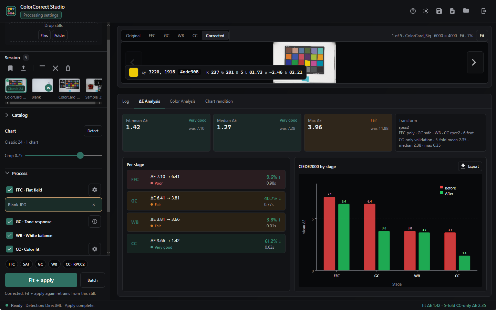

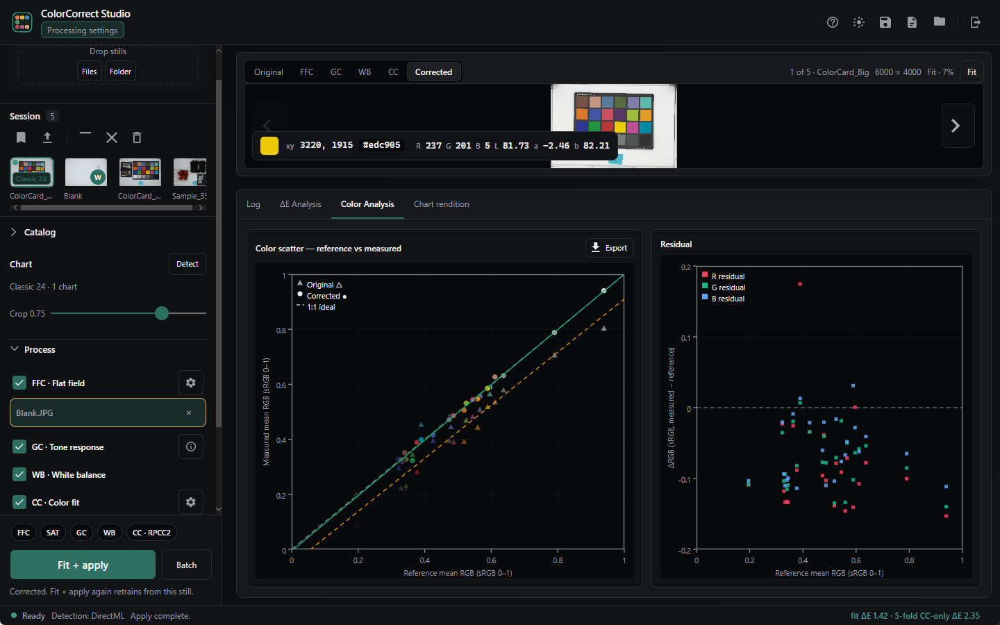

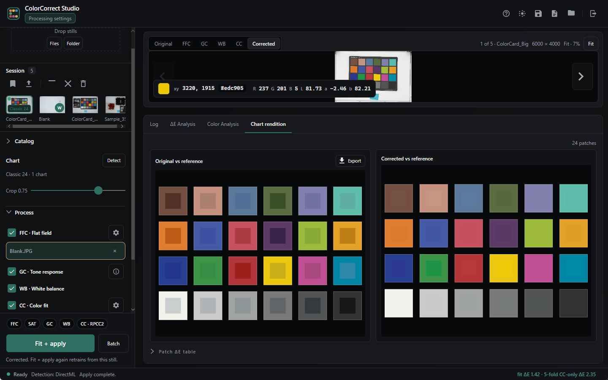

## 9. Batch

Apply the model to every other photo in the session.

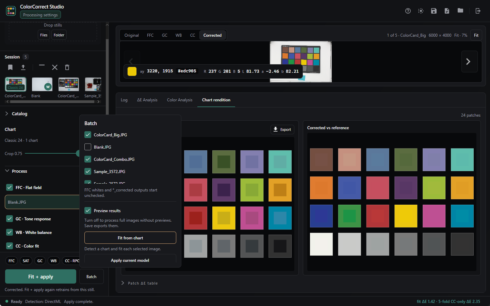

## 10. The Guide

F1 opens the in-app Guide.

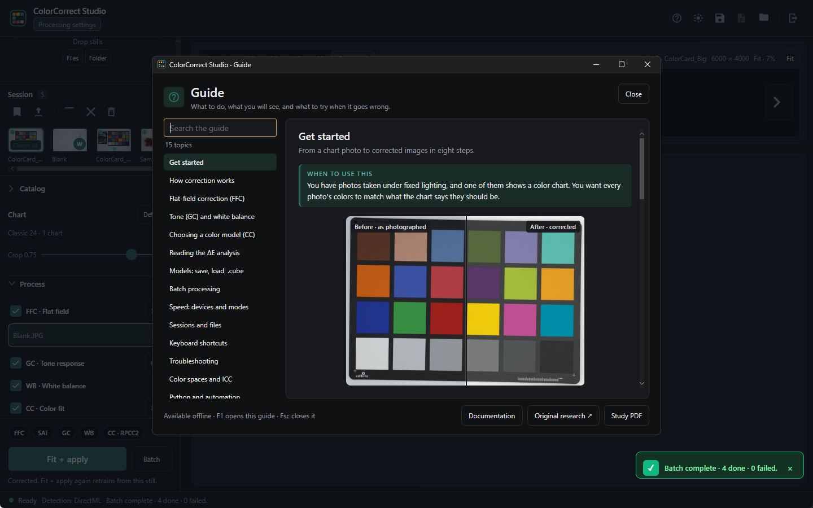
