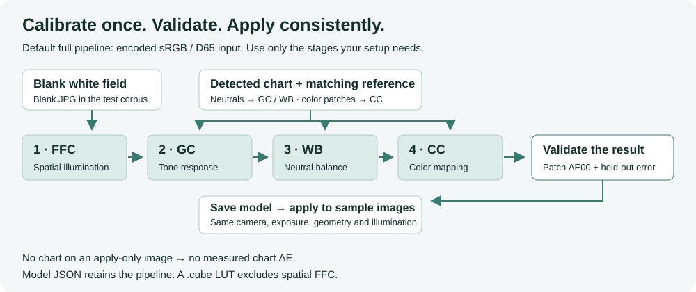
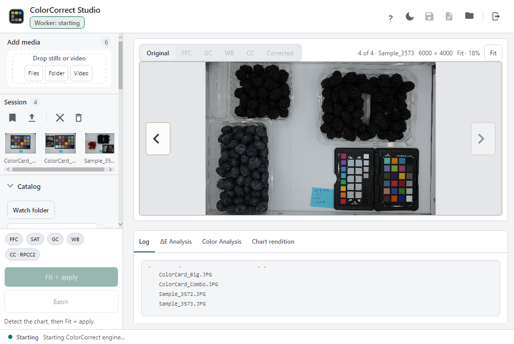
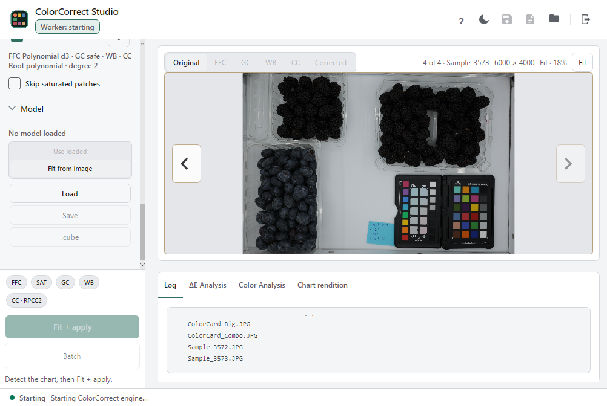
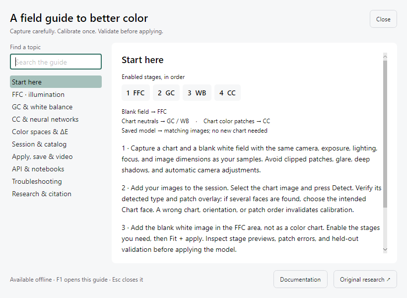

# ColorCorrect Studio guide

Open **?** in the toolbar or press **F1** for the searchable, offline in-app guide.
Escape closes it and returns focus to its trigger. The guide is bundled into the
application, so it does not depend on a browser or internet connection. Only the
explicit **Original research** link opens your browser.

## A reproducible first correction

The blank field supplies FFC. The **detected chart's neutral patches supply GC
and WB**, and its color patches supply CC. Each stage sees the enabled upstream
corrections. Validation comes before applying the saved model to other images;
application reuses GC rather than fitting a new curve without a chart.

1. Capture a chart and a blank white field with fixed exposure, focus, lighting,
   framing, and image dimensions. Avoid glare and clipped chart patches.
2. Add the chart-bearing image to the session and press **Detect**. Verify the
   detected chart type and patch overlay. If several faces are found, choose the
   intended **Chart face**.
3. Load the blank field in the FFC section. In the public sample set,
   `Blank.JPG` is the flat-field input, **not** the chart.
4. Start with encoded sRGB/D65 input. Enable the stages needed for your setup:
   FFC → GC → WB → CC. GC is automatic and has no degree setting.
5. Choose **Fit + apply**; inspect stage previews, per-patch ΔE00, and held-out validation. Do not
   judge a model by its training mean alone. Try a simpler model if validation
   worsens as complexity increases.
6. Expand **Model**, choose **Use loaded** (load model JSON first if needed), and
   select a sample image. Run **Apply model**. A successful fit makes the model available,
   but does not automatically switch from **Fit from image** to **Use loaded**.
   Apply to images captured under matching conditions. They need no chart,
   but have no measurable chart ΔE unless a chart is independently evaluated.
7. Press **Ctrl+S**, choose an output folder and outputs, then **Save selected**.
   Corrected images keep the source resolution; optional stage previews keep
   their preview resolution. Existing destinations require overwrite confirmation.
   Preview completion alone does not export these files. Save model JSON,
   reports, and the configuration too. Keep originals and outputs separate.

## Color interpretation matters

Input/output spaces describe **pixel encodings**. With sRGB/D65 input, embedded
ICC profiles are converted to working sRGB before processing; untagged images
are assumed sRGB. Other input selections use the actual stored pixel encoding,
bypassing ICC conversion. Select the actual input space and reference
white. Standard sRGB is D65; the same primaries with another white is a custom
variant. FFC/GC/WB require encoded sRGB/D65 input. Other inputs require conversion
before those stages, or CC-only processing.

Non-sRGB output must be interpreted using its declared encoding downstream. The
application converts corrected/stage worker previews to display sRGB separately
from the exported pixels; original previews and thumbnails honor ICC profiles
and EXIF orientation. It is not a calibrated proofing viewer. Numerical tests
cannot guarantee that a physical
chart matches nominal reference values. See [color-science validation](color-science-validation.md)
for the numerical checks, source provenance, and remaining boundaries.

Held-out chart scores test the CC mapping after GC/WB fitting. Use a separately
photographed validation chart to assess the complete pipeline. Refit older models
trained on tagged images whose profile was previously ignored.

## Does GC use the chart?

Yes. During fitting, GC uses the detected chart's named neutral patches, sampled
after FFC if enabled. It compares their measured L* to the corresponding reference
L*, and needs at least two usable named neutrals. It learns a monotonic lightness
curve anchored at black and white—not a fixed gamma exponent. **Apply model**
reuses that saved curve without needing a chart on subsequent images.

## Neural networks

The layer field accepts a width (`100`) or successive widths (`100, 30`,
`[64, 32]`, `[128, 64, 32]`), with one to four hidden layers. Choose Adam,
SGD with momentum, or RMSProp; optionally enable batch normalization and set
dropout from 0 to 0.8. Zero disables dropout. Record these choices with the
training settings, and compare held-out error. A best training checkpoint does
not establish generalization to another camera or lighting setup.

## Navigation and outputs

In this layout example, the left panel holds your working images and settings.
The large arrows browse session images; the tabs above the preview select
processing stages. The bottom-left action area stays reachable while settings scroll.

Expand **Process** to choose stages, use its settings buttons for details, and
scroll down to **Model** for loading, saving, and cube export. Disabled controls
need an active image or fitted/loaded result; the screenshot illustrates layout,
not a completed calibration.

- Alt+Left / Alt+Right or the preview arrows browse session **images**, not stages.
- Ctrl+O adds files; Ctrl+Shift+O adds a folder.
- Ctrl+Shift+S saves a session; Ctrl+Alt+O loads one.
- Ctrl+S saves output files; F5 runs; Ctrl+B opens batch; Ctrl+T changes theme.
- In Batch, choose **Apply current model** to reuse calibration. **Fit from chart** instead
  calibrates every selected chart-bearing image separately.
- Session, catalog, and process areas scroll when their content exceeds the panel.
- Model JSON preserves a reusable pipeline; cube LUTs exclude spatial FFC.

## Batch processing and previews

Open **Batch** or press **Ctrl+B**, choose **Apply current model** or **Fit from chart**,
then start the batch. **Preview results** is on by default. The choice is captured
when the batch starts; changing the next batch's setting does not change completed results.

With previews on, corrected previews appear as images finish. With previews off,
the app writes full-resolution corrected images into each result's own run folder
and skips creating or loading corrected previews. Choose **Save** to export those
images to your selected destination. **Show preview** explicitly opens an individual
completed result without enabling previews for the rest of the batch. Saved sessions
retain each result's preview choice.

The existing stage indicators and job bar track the current image, and the batch
bar tracks the whole queue. The overall bar includes completed images and the
current image's completed stages. Different stages take different
amounts of time, so the percentage is not an estimate of time remaining. A result
reaches 100% only after its output and captured settings are accepted.

Only applicable stages run. Spatial **FFC** runs separately. Fast mode applies the
enabled **GC**, **WB** and **CC** transforms together through one combined LUT;
their indicators run together during that pass. They are not three separate GPU
operations. Fitting can also show separate GC/WB/CC work while learning the model.
**Save result** covers the output or preview actually being created. Cancellation keeps
completed results, and a failed image does not erase earlier successes.

On WSL, file and folder selection uses a managed picker to avoid a native GTK
failure observed during testing. It opens over the app at a bounded size; press
Escape to cancel. Other desktop platforms retain their native
dialog selection.

## Automation and notebooks

All worker operations are available without the GUI. Start with the
[headless API documentation](api/README.md) and the two tutorials in `../notebooks/`.
Python is optional for the GUI. The public interface is a local worker process,
not an HTTP service; no network listener is enabled by default. Copy notebooks
to a writable working directory before running them from an installed app.

## Research and attribution

Search matches both topic titles and article text. **Documentation** opens the
bundled offline docs folder; **Original research** opens the article in your browser.

Wakholi, C., Hardigan, M. A., Lee, J., Lukas, S. B., Feldman, M. J., Altendorf,
K. R., Neyhart, J. L., & Rippner, D. A. (2026). *A systematic color correction
pipeline for controlled-environment imaging*. The Plant Phenome Journal, 9,
e70067. [Original article](https://acsess.onlinelibrary.wiley.com/doi/full/10.1002/ppj2.70067).
Publication metadata is also available from [USDA ARS](https://www.ars.usda.gov/research/publications/publication/?seqNo115=427505).

The study motivates a staged pipeline and careful control of the imaging setup.
The current application's automatic GC and NN safeguards are implementation
developments, not a claim to reproduce every historical experimental setting.

The guide uses native Avalonia controls rather than an embedded browser. Link
handling follows [Avalonia's Launcher API](https://docs.avaloniaui.net/docs/services/launcher).
Its UI tests check the native control tree, keyboard interaction, search, scrolling,
and rendered frames in both themes; HTML DOM tests do not apply to this app.
